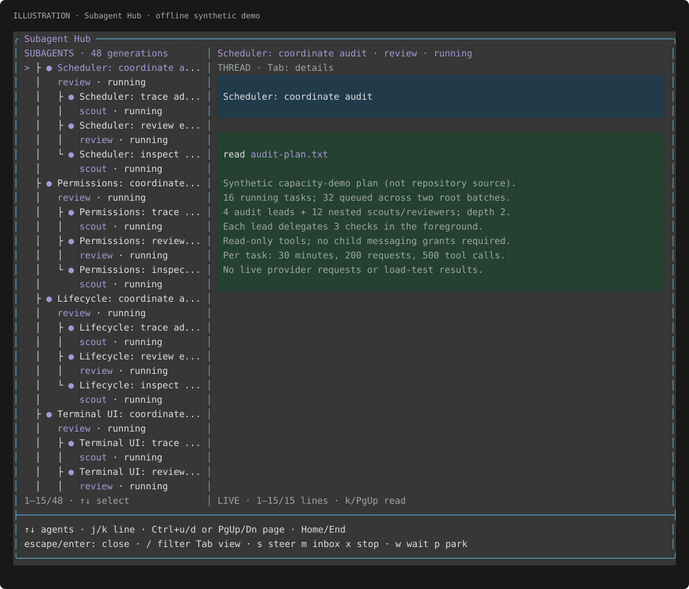
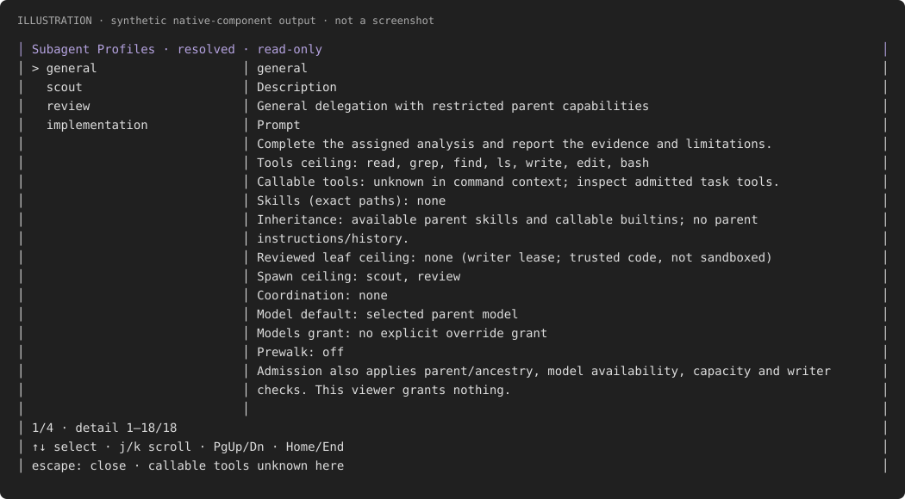
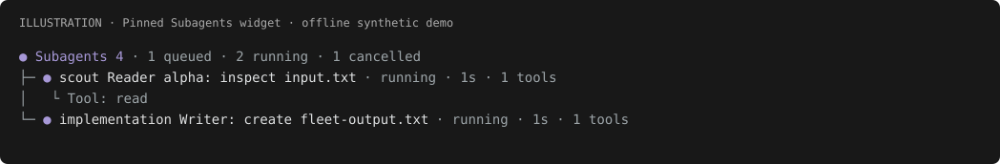

# @howarewoo/pi-subagents

[](https://www.npmjs.com/package/@howarewoo/pi-subagents)
[](https://www.npmjs.com/package/@howarewoo/pi-subagents)

Delegate work to subagents in Pi, follow their progress, and steer or stop them from Subagent Hub. Subagents use your selected model by default, with their own assignments and explicit tool grants.



_Subagent Hub: tasks and conversations side by side, with each profile and status aligned beneath its agent’s name. Illustrated with synthetic demo data._

## Installation

Requires Node 22.19+ and **stable Pi 1.5.2 or newer** for delegated execution. Pi 1.5.2
is the minimum; newer stable patch, minor and major versions are allowed. Standard build
metadata does not affect version precedence. Below-minimum, prerelease, malformed and
unknown host versions are rejected before task-file reads, child allocation, disk setup
or child model requests. **Tested host: Pi 1.5.2**; allowing future stable versions is not
a tested compatibility guarantee. Wildcard host peer dependencies are required by Pi's
package format; they are not a compatibility promise. SDK development packages stay pinned.

If execution reports an unsupported host, install stable Pi 1.5.2 or newer and restart Pi
after active tasks drain. Where the host can load the extension, root status, stop/cleanup
and diagnostics remain available; arbitrary ancient SDKs may fail to load the module at all.
This minimum-host restriction is a breaking change for the next minor release; the package
version is not bumped here.

Install from npm:

```sh
pi install npm:@howarewoo/pi-subagents
```

### Migrate from the old package

If you installed `pi-extended-subagents`, remove it before installing the scoped package
so Pi does not load the extension twice:

```sh
pi remove npm:pi-extended-subagents
pi install npm:@howarewoo/pi-subagents
```

Use only one source. When switching from Git to npm, remove the Git registration first with
`pi remove git:github.com/howarewoo/pi-extended-subagents`. The Git repository has not moved;
`pi install git:github.com/howarewoo/pi-extended-subagents` remains an alternative.

Restart Pi and run `/subagent-profiles` to check the installation. If you already installed a local checkout, remove that registration first with `pi remove /path/to/pi-extended-subagents` to avoid loading it twice.

## Updates and rollback

Let active subagents finish before updating, then restart Pi. Shutdown or `/reload` aborts
and drains children; active tasks are not migrated to the new version. There is no extension-owned
auto-updater.

```sh
# Update an unpinned npm installation
pi update npm:@howarewoo/pi-subagents

# Or update all installed extension packages
pi update --extensions
```

Plain `pi update` updates Pi itself, not installed extension packages. For a Git installation,
use `pi update git:github.com/howarewoo/pi-extended-subagents`; an unpinned Git source tracks
the repository's default branch, including unreleased commits.

For a reproducible npm installation or rollback, select an exact published version:

```sh
pi install npm:@howarewoo/pi-subagents@0.1.1
```

For Git, select a published tag, for example
`pi install git:github.com/howarewoo/pi-extended-subagents@v0.1.1`.
Exact npm versions and Git tags stay pinned; updating does not advance them to the next release.
Install a different version explicitly to change the pin.

[CHANGELOG.md](CHANGELOG.md) lists user-facing changes and migrations. Pi shows new package
changelog entries on the next fresh launch after a version increase. See the
[maintainer release guide](docs/releases.md) for publishing and recovery.

## Feature comparison

Compared with two community alternatives using their documentation, checked on 2026-11-11. Tintinweb's messaging scope was additionally checked against source at revision `b72b414` (2026-11-12). This is a feature comparison, not a performance or reliability benchmark. UI cells name documented surfaces; they do not imply other features are absent.

| Feature                        | @howarewoo/pi-subagents                                                                                         | [nicobailon/pi-subagents](https://github.com/nicobailon/pi-subagents)                                                                                                                            | [tintinweb/pi-subagents](https://github.com/tintinweb/pi-subagents)                                                                                                                                                    |
| ------------------------------ | --------------------------------------------------------------------------------------------------------------- | ------------------------------------------------------------------------------------------------------------------------------------------------------------------------------------------------ | ---------------------------------------------------------------------------------------------------------------------------------------------------------------------------------------------------------------------- |
| Background tasks               | ✅ [Parent-bound by design; until exit or reload](#why-background-tasks-are-parent-bound)                       | ✅ Supported                                                                                                                                                                                     | ✅ Supported                                                                                                                                                                                                           |
| Nested delegation              | ✅ [Supported](#why-nested-delegation-is-foreground-only)                                                       | ✅ Supported                                                                                                                                                                                     | ✅ Supported                                                                                                                                                                                                           |
| Task list / conversation       | ✅ [Subagent Hub: split panes; full-width thread on narrow terminals](#why-the-ui-observes-one-native-registry) | ✅ Fleet inspector: roster and output pane                                                                                                                                                       | ✅ FleetView opens a separate conversation viewer                                                                                                                                                                      |
| Message / tool rendering       | ✅ [Native Pi message and tool components](#why-the-ui-observes-one-native-registry)                            | ✅ Structured Markdown/tool transcripts                                                                                                                                                          | ✅ Markdown + session-registered tool renderers                                                                                                                                                                        |
| Bi-directional agent messaging | ✅ [Supported; parent/child and siblings](#why-agent-messaging-is-family-scoped)                                | ⚠️ [Child/supervisor requests and replies](https://github.com/nicobailon/pi-subagents/blob/c99503aed6d6b20d2397a1767f7d60730efe3963/docs/workflows.md#supervisor-coordination-child-asks-parent) | ⚠️ [Parent-to-child steering + result return; no built-in child-initiated or sibling messaging](https://github.com/tintinweb/pi-subagents/blob/b72b414581d8aa9bbfb1d44c832aed0d0b0b9053/src/nested-tools.ts#L400-L430) |
| Live follow / scrollback       | ✅ Scroll up to pause; End to follow                                                                            | ✅ Scroll away to pause; bottom resumes                                                                                                                                                          | ✅ Scroll up to pause; End to follow                                                                                                                                                                                   |
| In-UI task controls            | ✅ [Hub: steer, inbox, stop, wait, park](#why-controls-are-identity-pinned)                                     | ✅ Inspector: steer/follow-up and stop async runs                                                                                                                                                | ✅ Viewer: steer, stop, foreground-to-background handoff                                                                                                                                                               |
| Tool / usage inspection        | ✅ [Tools: sanitized arguments/results; Details: direct usage](#why-the-ui-observes-one-native-registry)        | ✅ Expandable tool details + token counts                                                                                                                                                        | ✅ Expandable tool output + tokens; optional cost                                                                                                                                                                      |
| Schema-validated results       | ✅ [Supported](#why-structured-results-require-explicit-submission)                                             | ✅ Supported                                                                                                                                                                                     | ⚠️ Workflow agents only                                                                                                                                                                                                |
| Managed Git worktrees          | 🚫 [By design; caller-managed worktrees supported](#why-workspaces-are-caller-managed-and-writers-serialize)    | ✅ Supported                                                                                                                                                                                     | ✅ Supported                                                                                                                                                                                                           |
| Workflow scripts               | 🚫 [By design; caller-owned](#why-orchestration-stays-with-the-caller)                                          | ✅ Supported                                                                                                                                                                                     | ✅ Supported                                                                                                                                                                                                           |
| Scheduled runs                 | 🚫 [By design; no scheduler](#why-orchestration-stays-with-the-caller)                                          | ✅ Supported                                                                                                                                                                                     | ⚠️ Session-scoped agents only                                                                                                                                                                                          |

Legend: ✅ Supported (stated design boundaries apply) · ⚠️ Supported with scope restrictions · 🚫 By design.

🚫 marks a deliberate product boundary, not a missing implementation within the current
contract. Linked explanations describe the trade-offs behind this repo's choices.

Sources: [our contract](docs/delegation-contract.md); nicobailon's [README](https://github.com/nicobailon/pi-subagents/blob/c99503aed6d6b20d2397a1767f7d60730efe3963/README.md), [agents](https://github.com/nicobailon/pi-subagents/blob/c99503aed6d6b20d2397a1767f7d60730efe3963/docs/agents.md), [workflows](https://github.com/nicobailon/pi-subagents/blob/c99503aed6d6b20d2397a1767f7d60730efe3963/docs/workflows.md) and [observability](https://github.com/nicobailon/pi-subagents/blob/c99503aed6d6b20d2397a1767f7d60730efe3963/docs/observability.md); tintinweb's [README](https://github.com/tintinweb/pi-subagents/blob/8df7fa7d8e8130151a8fbfa991a1d3fa6b443739/README.md) and [workflows](https://github.com/tintinweb/pi-subagents/blob/8df7fa7d8e8130151a8fbfa991a1d3fa6b443739/docs/workflows.md).

## Architectural decisions

These choices define the current execution contract and its trade-offs. They are not
claims that other designs are unsafe or impossible. Deferred capabilities are identified
separately; an unsupported feature is not automatically a permanent exclusion.

### Why background tasks are parent-bound

Background tasks let the parent continue while children work. They remain owned by the
parent Pi runtime: normal shutdown or `/reload` cancels active children, waits for their
tools and descendants to drain, and disposes their sessions. Closing Subagent Hub does
not stop them.

This keeps execution and cleanup under the same owner. A task does not become an
unattended job that can continue editing files or making provider requests after you
close Pi. Capacity and writer leases remain held until work actually drains, so a
replacement writer cannot start while a cancelled tool is still active. Cancellation
can take time if provider, permission or tool code does not respond to abort; abrupt
process death cannot guarantee cleanup.

The trade-off is that you must keep the parent runtime alive for work to finish. There
is no detached runner or restart recovery. Saved transcripts and result artifacts are
inspection records, not a way to resume running tasks after restart. Within the same
runtime, paused tasks can continue their retained conversation; follow-up work for a
completed task starts a fresh session and generation.

The alternatives use different boundaries. In the versions cited above, nicobailon's
background children run in a detached process that can keep working independently of
the parent. Tintinweb stops agents on session shutdown, but supports persisted
conversation resume and moving an active foreground run into the background. Persisting
a conversation does not itself keep a running job alive after exit.

See [the delegation contract](docs/delegation-contract.md) for cancellation, drain and
continuation semantics.

### Why nested delegation is foreground-only

A child may delegate only to explicitly granted profiles within its ancestry and depth
limits. Nested calls wait for their children, and the waiting parent retains its
execution slot. Admission rejects nested work that cannot start immediately instead of
queuing it behind its own waiting ancestors or silently lending extra capacity.

This makes ownership and concurrency limits predictable, at the cost of rejecting some
fan-out patterns that could run with a different scheduler. A writing child cannot
spawn another writer beneath itself. Parent completion or stop drains descendants;
there are no detached grandchildren. See [lifecycle and scheduling](ARCHITECTURE.md#lifecycle-and-scheduling).

### Why permissions and resources are explicit

A profile defines a tool ceiling, intersected with the parent's callable tools. Builtin
calls go through the original parent dispatcher so permission hooks still apply.
Operator grants define authority; trusted-project configuration and task requests can
only narrow it. Choosing another workspace does not load that workspace's trust policy.

Children receive their assignment, role prompt and granted skills, without automatically
receiving parent instructions, conversation history or ambient project context. General
inherits available skills and can receive exact operator-reviewed leaf tools, but full
extension/MCP runtime inheritance and tool-to-tool forwarding are unsupported. This
keeps executable-resource authority explicit, at the cost of requiring complete task
handoffs and narrower integrations. Tool grants and cwd adaptation are not an OS sandbox.
See [permission and resource boundaries](ARCHITECTURE.md#permission-and-resource-boundaries).

### Why model routing is exact

Children use the parent's selected model and effort by default. Overrides require exact
operator-approved provider/model/effort grants; unavailable selections and unsupported
effort fail visibly instead of falling back. Authentication remains with the parent's
model registry rather than being copied into child task directories.

This preserves the requested routing and credential owner, but does not automatically
choose cheaper models or substitute another provider. An explicitly configured role
prewalk can make one approved model switch after an edit/write call; it adds no hidden
planning inference. See [models and authentication](ARCHITECTURE.md#models-and-authentication).

### Why workspaces are caller-managed and writers serialize

The caller supplies an existing workspace, which may already be a worktree. The extension
adapts builtin paths and shell cwd while retaining parent permission hooks. Worktree
creation, branch and base selection, integration and cleanup belong to the caller or
separate tooling, not this extension. This keeps the extension focused on subagent
execution, coordination and UI rather than repository lifecycle management.

Selecting a workspace is not filesystem containment: paths and shell commands can reach
outside it when parent permissions allow. The extension does not provide an OS sandbox.

Within this parent runtime, effective writing tasks share one writer lease, even across
different workspaces. Coordinated parent model-tool mutations cannot overlap a child
writer, and the lease is held through actual drain. This avoids assuming that separate
cwd values isolate every possible write, but sacrifices parallel writing throughput.
Manual shell commands, external editors and other sessions remain uncoordinated; the
operator must avoid conflicting writes. See [tool execution and workspaces](ARCHITECTURE.md#tool-execution-and-workspaces)
and [explicit working directory](docs/delegation-contract.md#explicit-working-directory).

### Why structured results require explicit submission

When a task has a result schema, the child must call `submit_result` with a value that
passes the supported bounded JSON Schema subset. Final prose is not parsed as a result.
A valid submission remains provisional until execution and descendants drain: it cannot
turn cancellation or a model failure into success, and missing required submission fails
the task.

This gives callers an explicit result boundary, at the cost of narrower schema support
and an extra submission step. Whole batches pass preflight before any child is admitted;
results remain in input order, and a failed child does not cancel unrelated siblings.
Background batches deliver one outcome message after the batch drains, so a fast result
may wait for slower siblings. See [results and persistence](ARCHITECTURE.md#results-and-persistence).

### Why the UI observes one native registry

Subagent Hub, the widget and tool result cards observe the same coordinator; opening a
viewer does not create another executor. Native Pi message and tool components render
the child conversation, with terminal-facing content sanitized. The split-pane Hub keeps
the roster and selected thread together, switching to a full-width thread on narrow
terminals.

This keeps observation tied to execution state and Pi's rendering conventions, while
making the interface dependent on supported host components. Usage is reported directly
for each generation rather than inferred or recursively added into parent totals;
missing provider usage is not estimated. Sanitized display does not redact saved files.
See [observation and terminal UI](ARCHITECTURE.md#observation-and-terminal-ui).

### Why controls are identity-pinned

Controls target a UUID and generation so stale selections cannot steer or stop a newer
assignment. Paused continuation retains the same conversation; follow-up or revival of
completed work creates a fresh generation under current, narrowed authority. Prior
transcripts are not automatically replayed, so the caller must supply needed conclusions.

Hub controls use the same registry authority as the tools. Starting a new generation
requires a model-issued tool call because Pi's Hub command context lacks the
permission-preserving tool dispatcher. Messaging and waits are opt-in, bounded and
family-scoped; delivery receipts establish visibility, not model acknowledgment. The
trade-off is more explicit handoffs and fewer direct UI actions. See [coordination,
presence and generations](ARCHITECTURE.md#coordination-presence-and-generations).

### Why agent messaging is family-scoped

Explicit coordination grants allow messages in both directions between a parent and its
children, and between siblings with the same exact parent generation. The sender must
already know the recipient's UUID and generation from the handoff or a message. There is
no child-wide registry enumeration, arbitrary cross-session addressing or peer transcript
access. This allows live collaboration without granting visibility into every agent.

`delegate_coordinate` supports inbox messages, steering/follow-up delivery and bounded
event-driven waits. Messages require running recipients; an inbox message does not
automatically trigger parent inference. Receipts distinguish acceptance, queuing and
actual visibility, none of which proves model acknowledgment. Mailboxes and waits have
finite limits, waits retain capacity, and dependency cycles are rejected. The trade-off
is that callers must arrange identities and reply handling; this is not a durable broker
or an automatic blocking supervisor interview.

In the cited versions, nicobailon documents child-initiated `contact_supervisor` requests
and parent `subagent_supervisor` replies, including nested supervision. Tintinweb implements
parent-to-child steering and child result notifications. Source inspection at `b72b414`
found no built-in child-initiated request/reply channel or sibling messaging: its
[nested steering tool](https://github.com/tintinweb/pi-subagents/blob/b72b414581d8aa9bbfb1d44c832aed0d0b0b9053/src/nested-tools.ts#L400-L430)
restricts targets to children owned by the caller, and its
[completion outbox](https://github.com/tintinweb/pi-subagents/blob/b72b414581d8aa9bbfb1d44c832aed0d0b0b9053/src/index.ts#L466-L497)
returns results rather than exposing a child-callable upstream messaging tool.
These are different communication contracts, not equivalent checkmarks. See the
[live coordination contract](docs/delegation-contract.md#live-parent-messaging-waits-and-presence) for exact grants,
addressing and limits.

### Why orchestration stays with the caller

The extension provides bounded assignments and live coordination. The caller owns the
larger plan and workspace preparation. The native `subagent` interface adapts to the same
executor; it is not a general interpreter for competitors' workflow scripts or custom
agent definitions.

There is no workflow-script runtime or scheduling service in the current product.
Keeping those outside this extension avoids a second execution and lifecycle system,
but means saved scripts, recurring jobs and automatic workspace preparation need other
tooling. Schedules would also need their own ownership contract beyond the current
parent-bound assignments. This is the current scope, not a claim that such features
cannot be built. See [entry points and runtime ownership](ARCHITECTURE.md#entry-points-and-runtime-ownership).

## Native orchestration

Pi discovers the native `subagent` tool at startup through its tool description and coding-worker guidance; no enable call is needed. For replacement use, load only one extension providing `subagent`: Pi uses the first registration, not an automatic provider preference. Switching providers does not migrate or remove old runs.

```json
{
  "agent": "worker",
  "task": "Implement the approved change; follow the supplied repository guidelines and task references",
  "cwd": "/absolute/path/to/task-worktree"
}
```

`worker` uses the configured `implementation` profile. `scout`, `review` and `general` are also available. Calls are async by default and wake the parent after drain; set `async:false` to wait. Batches use `tasks:[{agent,task,cwd?}]`. Use the returned `id` with `action:"status"`, `"steer"`, `"stop"` or `"resume"`; steer/resume also need `message`. Resume continues a paused conversation in the same generation; for completed idle/parked work it starts a fresh generation, so include needed prior conclusions.

The coordinator supplies an existing workspace and the complete handoff, including accessible skill/reference paths. The extension does not create or manage worktrees. This is the [supported orchestration interface](docs/delegation-contract.md#native-orchestration-compatibility), not compatibility with every competing workflow script or custom agent definition.

## Use delegation

Choose a model through Pi's `/login` and `/model` setup. Delegation uses that provider and may incur charges; it does not automatically switch to a cheaper model.

Ask Pi:

> Use delegate_task with profile scout to locate the startup lifecycle code and report source locations. Run it in the foreground.

The corresponding tool call is:

```json
{
  "assignment": "Locate startup lifecycle code and report source locations",
  "profile": "scout",
  "background": false
}
```

Or submit a batch:

```json
{
  "tasks": [
    { "assignment": "Locate startup code", "profile": "scout" },
    { "assignment": "Review lifecycle tests", "profile": "review", "limits": { "requests": 20 } }
  ],
  "background": false
}
```

The default is 16 concurrent tasks, a 32-item queue and up to 16 tasks per batch. Every item passes preflight before any starts. One failed task does not cancel its siblings.

`scout` and `review` allow up to `read`, `grep`, `find` and `ls`. `general` and `implementation` also allow `write`, `edit` and `bash`. Each role receives only the builtins already callable in the parent. With Pi's default tools, scouts get `read` only. Tool calls retain the parent's permission hooks; incompatible tool overrides are rejected.

`general` also inherits the parent's available skills, not its instructions or conversation history. Its existing role prompt and supplied assignment remain intact. Operator/trusted-project configuration can narrow inheritance with `tools` and `skills` (explicit `[]` removes grants). General can write when its inherited builtin set includes writing tools.

Non-builtin inheritance is **restricted**: the operator may set `general.leafTools` to exact reviewed extension/MCP tool names in `delegation.json`. This is an assertion that the trusted implementation is a leaf: it never calls other Pi tools or changes the tool/model/session loadout. Unknown tools are denied, not automatically trusted from their descriptions or annotations. Declared reaching tools, codemode, tool search, owned delegation controls, hidden/model-only tools, and builtin replacements are never forwarded this way. Leaf tools are denied when child cwd differs from root cwd; only builtins have a workspace adapter. All admitted leaf tools conservatively require the global writer lease. See [restricted inheritance](docs/delegation-contract.md#restricted-general-inheritance) for the trust boundary and diagnostics.

Foreground calls return the final results. Set `background:true` to return immediately and receive one ordered completion message after the batch drains. Use the returned task ID and generation for controls:

```text
/subagent-profiles
/subagent-status
/subagent-status <id> <generation>
/subagent-steer <id> <generation> <text>
/subagent-stop <id> <generation>
/subagent-hub
```

## Subagent Profiles

Run `/subagent-profiles` to inspect the resolved profiles for the current workspace: bundled definitions, operator `delegation.json`, then trusted-project narrowing. It opens a read-only list/details overlay, not an editor. Reopen it after configuration changes to refresh the snapshot.

Use ↑/↓ to select a role; j/k, PgUp/PgDn and Home/End scroll details; Esc closes (configured selection bindings also apply). Narrow terminals stack the list above details; tiny terminals ask you to resize. Details show the description, prompt, builtin tool ceiling, exact skill paths, spawn/coordination ceilings and model/prewalk policy.

**Ceilings are not callable tools.** Pi's command context has no callable-tool dispatcher, so the viewer reports effective tools as unknown rather than treating active declarations as executable grants. Admission performs the real intersection and remaining checks; inspect a task's `tools` in `/subagent-status` or Hub Details. RPC, JSON and print modes retain the structured `{toolPolicy, profiles}` message instead of opening an overlay. Invalid configuration or missing/invalid granted skills fails resolution, as at admission.



_Synthetic native-component output; not a terminal screenshot or live-provider verification._

## Subagent Hub

Subagent Hub shows the subagent list beside the selected conversation, using Pi's native message and tool rendering. On narrow terminals, the conversation takes the full width. A border-colored horizontal rule separates the conversation and task list from the visible footer; it is omitted when the footer is hidden at tiny sizes. Details includes results, artifacts, grants and usage; Tools shows full sanitized arguments and result text.

The thread follows new output until you scroll up. Press End to follow again. The pinned Subagents widget appears after the first task starts. Closing Subagent Hub does not stop the work.

These illustrations use native renderer output with synthetic data modeled on the [offline fleet demo](examples/controlled-fleet.ts); they are not terminal screenshots.



_Pinned Subagents widget: task counts and recent activity stay visible above the editor._

| Key                   | Action                                            |
| --------------------- | ------------------------------------------------- |
| ↑ / ↓                 | Select a subagent or historical generation        |
| j / k                 | Scroll down / up one line                         |
| Ctrl+u/d or PgUp/PgDn | Scroll a page                                     |
| Home / End            | Top / latest output                               |
| Tab                   | Switch between thread, details and tools          |
| /                     | Filter the subagent list                          |
| s / m                 | Steer / send an inbox message                     |
| x, then y             | Stop the selected subtree; Enter does not confirm |
| w / p                 | Wait briefly for an outcome / park an idle task   |
| Esc                   | Cancel input or close the Hub                     |

Mouse-wheel scrolling works in fullscreen mode. In regular mode, use the keyboard controls because the terminal owns mouse scrollback. Actions stay pinned to the original task and generation; controls refuse to submit if the window cannot show the full target.

## Messages and follow-up work

Use `delegate_coordinate` to message a running subagent, wait for an outcome or assign follow-up work. Include it in any explicit tool allowlist alongside `delegate_task`.

```json
{"action":"message","target":{"id":"<task-id>","generation":1},"text":"Check the shutdown path too","mode":"steer"}
{"action":"wait","target":{"id":"<task-id>","generation":1},"timeoutMs":30000}
{"action":"followup","target":{"id":"<task-id>","generation":1},"assignment":"Now review the cancellation path"}
```

Each line is a separate call. An accepted or queued message is not a delivery confirmation; even a delivered receipt does not prove the model understood it. Follow-ups start a new generation without replaying the old conversation, so include the context it needs. Follow-up and revival are model-tool operations, unavailable directly in Subagent Hub. Child messaging is off until explicitly granted. See the [coordination reference](docs/delegation-contract.md#live-parent-messaging-waits-and-presence).

### Task files and structured results

Use `taskFile` instead of `assignment` to read instructions from a workspace-relative text file. Add `resultSchema` when you need a validated JSON value:

```json
{
  "taskFile": "tasks/review.txt",
  "profile": "review",
  "resultSchema": {
    "type": "object",
    "properties": { "summary": { "type": "string" } },
    "required": ["summary"],
    "additionalProperties": false
  }
}
```

Task files must be regular UTF-8 files of 1 to 50000 bytes, outside hidden paths and `node_modules`. Reads use the parent's permission hooks. Schema-required children call `submit_result({value:...})`; missing or invalid results fail visibly. See [supported schemas](docs/delegation-contract.md#required-structured-results) and [task-file checks](docs/delegation-contract.md#checked-task-file-input).

## Configuration

No configuration is needed for the bundled roles. To change prompts or narrow tools, use `~/.pi/agent/delegation.json`:

```json
{
  "review": {
    "tools": ["read", "grep"],
    "skills": ["/absolute/operator-reviewed/review/SKILL.md"],
    "prompt": "Review this assignment and report concrete findings with source locations."
  }
}
```

All bundled profiles may delegate to `scout` and `review` by default, within a total depth of two (root 0, child 1, grandchild 2). Other nested targets and child messaging need explicit operator grants. Set `spawn: []` to revoke nesting. General inherits available parent skills; other roles need explicit skill grants. Trusted project configuration in `.pi/delegation.json` can narrow grants, never expand them. Children do not load ambient extension/MCP runtimes or context files; general can forward only the reviewed leaf tools described above.

Each task defaults to a 30-minute deadline (1800000ms), 100 model requests and 100 tool calls. The deadline pauses the active subtree after actual tool/provider drain, releasing capacity and writer leases while retaining each idle SDK session and its full conversation. Use `subagent` resume or root-only `delegate_coordinate` `{action:"resume",target:{id,generation},assignment:"Continue…"}` to append a continuation to the same identity and conversation. Resume resets only the deadline window, not cumulative request/tool/spawn counters. Resume the parent first, then explicitly selected children; descendants never resume automatically. Stop, shutdown and hard request/tool limits still cancel and dispose. Unresponsive code must drain before either pause or cancellation can release resources. See [limits and nesting](docs/delegation-contract.md#capacity-and-bounded-execution), [Subagent Profiles](docs/delegation-contract.md#subagent-profiles-and-explicit-spawn-grants), and [exact model selection and prewalk](docs/advanced-policies.md).

## Shared checkout and lifetime

Subagents use your checkout by default, or an existing directory selected by `cwd`. File paths and shell commands are explicitly adapted through the original parent permission hooks; hooks still run in the parent context and may deny the selected paths. Writing tasks serialize through one global model-tool writer lease, even across worktrees. It does not coordinate manually entered `!`/`!!` commands, external editors, other terminals, other Pi sessions or arbitrary extension JavaScript. Avoid conflicting edits while a subagent is writing. A supplied worktree is not an OS sandbox; there is no automatic copy/apply or cleanup.

Work belongs to the live parent runtime. Shutdown or reload aborts and drains children; there is no restart recovery or cross-parent revival. Saved transcripts and results can contain sensitive task, tool and model output. Treat them like your main Pi transcripts.

### Why worktrees are managed externally

The separation is intentional: the extension owns subagent execution, coordination and UI; an external coordinator or worktree tool owns worktree creation, branch and base selection, integration and cleanup.

Worktrees are supported and useful for subagent orchestration. Create a worktree externally or select an existing workspace, then pass its path as `cwd` for the assigned subagent, as in the [native orchestration example](#native-orchestration). The caller owns the workspace before, during and after the assignment, including inspecting changes, integrating them and deciding when to remove it. The extension does not automatically create worktrees, commit, apply changes or clean up worktrees; this is an intentional scope boundary, not a planned feature.

Separate worktrees do not bypass the global model-tool writer lease or provide an OS sandbox. Effective writing tasks still serialize even when their `cwd` values differ.

### Why workflows and scheduling stay external

This package is a focused delegation method, not a general-purpose automation framework. It provides explicit assignments and grants, bounded execution, coordination, and inspectable results in Subagent Hub. Ordered batches and live coordination are supported orchestration features, distinct from workflow scripts and scheduled runs.

Workflow scripting and scheduling can live in separate packages that compose the public delegation tools and own when and how to delegate within the live parent runtime. They need not be built into this subagent integration. This separation implies neither a new built-in integration nor automatic inheritance of workflows, tools or context, and does not promise compatibility with existing third-party packages.

## Documentation

- [Delegation contract](docs/delegation-contract.md): tools, permissions, lifecycle and storage.
- [Advanced policies](docs/advanced-policies.md): models, prewalk and unsupported capabilities.
- [Verification](docs/verification.md): checks, terminal evidence and known limits.
- [Parity inventory](docs/parity-inventory.md), [provenance](docs/provenance.md), [third-party notices](THIRD_PARTY_NOTICES.md).

## Local development

From a source checkout:

```sh
npm ci --ignore-scripts
npm run lint
npm run format:check
npm run typecheck
npm test
npm run exercise
npm pack --dry-run
npm run test:package
```

`npm run check` runs lint, formatting, typecheck, tests and the controlled SDK exercise.
`npm run test:package` packs and installs the tarball in a temporary directory, then checks
that Pi loads the production entrypoint and registers its tools. It needs registry access
for runtime dependencies, does not use model credentials and leaves your Pi settings unchanged.

Oxlint checks correctness rules; warnings fail the lint command. Control-character regexes are allowed in terminal rendering code and tests because they match ANSI escape sequences. Run `npm run lint:fix` for safe lint fixes and `npm run format` to apply Oxfmt formatting. Formatting skips the generated lockfile and the managed Pullfrog workflow.

Load the production entrypoint with `pi -e /absolute/path/to/src/pi-extended-subagents.ts`. Tests and examples use controlled providers without credentials or live inference.

### Offline CLI walkthrough

Run this from the checkout in a disposable workspace. The controlled example deliberately starts a long background child; normal print-parent exit aborts it.

```sh
repo="$PWD"
root="$(mktemp -d)"
node_bin="$(command -v node)"
mkdir -p "$root/home" "$root/workspace"
(
  cd "$root/workspace"
  env -i PATH="$PATH" HOME="$root/home" PI_CODING_AGENT_DIR="$root/agent" PI_OFFLINE=1 \
    "$node_bin" "$repo/node_modules/@earendil-works/pi-coding-agent/dist/bundle/cli.js" \
    --offline --no-extensions --no-mcp --no-skills --no-prompt-templates \
    --no-themes --no-context-files --tools read,grep,find,ls,delegate_task \
    --session-dir "$root/sessions" -e "$repo/src/pi-extended-subagents.ts" \
    -e "$repo/examples/controlled-parent.ts" -p 'delegate example' </dev/null
)
# Inspect only these new files before removing the temporary walkthrough root:
find "$root/sessions/delegation" -name '*.jsonl'
rm -rf -- "$root"
```

The child's JSONL records `stopReason:aborted`. Do not install the controlled example as a production provider. This checks the SDK lifecycle, not live-provider reliability.

For the UI exercise, create `input.txt` in a disposable cwd. Run the local CLI with `--offline --no-extensions --no-mcp --no-skills --no-prompt-templates --no-context-files`, `-e /absolute/path/src/pi-extended-subagents.ts -e /absolute/path/examples/controlled-fleet.ts`, and tools `read,grep,find,ls,write,edit,bash,delegate_task,delegate_coordinate`. Enter `fleet example`, then `/subagent-hub`. `/fleet-theme dark` and `/fleet-theme light` switch themes. `fleet coordinate <JSON>` calls the coordination tool. The example writes `fleet-output.txt`; it is not loaded by the package manifest.

### Saved output

New files live under the parent session directory:

```text
delegation/<parent-session-id>/<task-id>/
  agent/                     # scoped child runtime cache location, no copied credentials
  transcripts/<new-id>.jsonl # actual SDK messages/tool results
  result.txt                 # complete last-assistant text after drain (when referenced)
  structured.json            # accepted JSON value, if supplied (when referenced)
```

Completed generations keep their own immutable files. New generations use `<task-id>-g<generation>/`. Old `extended-subagents-proof` data is left untouched and is not loaded or migrated. SDK hosts must emit the public shutdown lifecycle before disposal; bare `session.dispose()` does not perform that cleanup.
